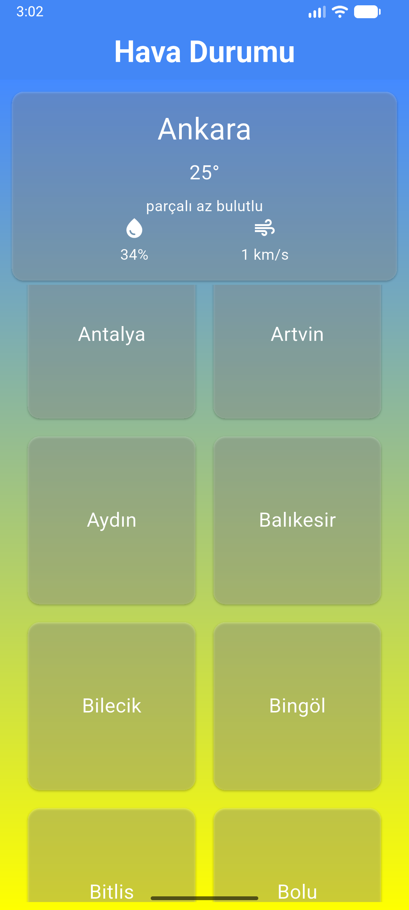
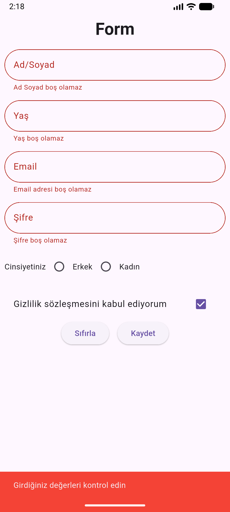

# Flutter Mini Projeler

Flutter öğrenme sürecinde geliştirilen dört küçük mobil uygulama örneği. Her proje ayrı bir Flutter klasöründe yer alır; ekran görüntüleri de aşağıda gösterilmiştir.

## Projeler

| Klasör | İçerik | Öne çıkanlar |
| --- | --- | --- |
| `flutter_proje1` | Kişisel profil ekranı | Profil fotoğrafı, okul bilgileri, hakkında/amaç kartı ve örnek aksiyon butonları |
| `flutter_proje2` | Kişiler listesi | JSON varlığından kişi listesi yükleme, kartlı görünüm ve geçici kişi ekleme |
| `flutter_proje3` | Hava durumu | OpenWeatherMap üzerinden şehir seçerek güncel hava verisini ve temel ölçümleri görüntüleme |
| `proje4` | Kullanıcı kayıt formu | Form doğrulama, e-posta kontrolü, yaş/şifre koşulları, cinsiyet ve sözleşme alanları |

## Ekran görüntüleri

### Proje 1 — Profil ekranı


### Proje 2 — Kişiler listesi


### Proje 3 — Hava durumu


### Proje 4 — Kayıt formu


## Çalıştırma

Her uygulama bağımsız bir Flutter projesidir. Çalıştırmak istediğiniz klasöre geçip bağımlılıkları yükleyin ve uygulamayı başlatın:

```bash
cd flutter_proje1
flutter pub get
flutter run
```

`flutter_proje2`, `flutter_proje3` veya `proje4` için klasör adını değiştirin. Hava durumu uygulamasının ayrıca API anahtarı yapılandırması gerekir; yönergeler `flutter_proje3/README.md` içindedir.

## Öğrenme konuları

Bu örnekler Flutter widget düzeni ve tema oluşturma, yerel JSON varlıklarını okuma, HTTP API tüketimi, model sınıfları ve form doğrulama gibi temel konuları kapsar.